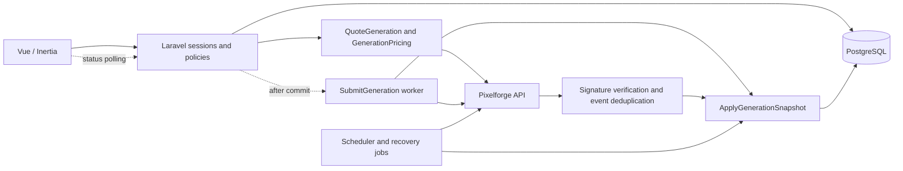

# Pixelforge Studio

A usage-priced image creation workspace built for the PromptEdit Senior Product
Engineer assessment. Compose a prompt, review a server-calculated estimate, and
follow the asynchronous result through to an exact, inspectable final charge.

[Live application](https://pixelforge-production-hcilan.laravel.cloud/) ·
[Source](https://github.com/AnirudhVijayaraghavan/PixelForge) ·
[Provider reference](https://pixelforge.promptedit.dev/docs) ·
[Verification evidence](docs/VERIFICATION.md)

Pixelforge is the assessment's simulated provider: images are placeholders and
charges are simulated. The integration uses live HTTP requests, asynchronous
workers, signed webhooks, and persistent financial records. Ordinary prompts
work; provider testing keywords are optional controls for predictable scenarios.

## Features

- **Studio:** prompts up to 4,000 Unicode characters; three sizes and quality
  levels; up to four HTTP(S) reference URLs; account-scoped tab drafts.
- **Pricing before submission:** debounced server quotes, dynamic provider rates,
  estimated ranges, and explicit loading/unavailable states. Creation reprices
  independently; an estimate is not a guaranteed cap.
- **Generation history:** owned records, 12-per-page pagination, live local-status
  polling, result images, failure states, and prompt reuse without automatic
  submission. Polling pauses in hidden tabs and stops for terminal work.
- **Cost Inspector:** confirmed category usage, accepted rates, category costs,
  exact provider cost, 25% markup, actual customer charge, and estimate difference.
- **Authentication:** registration, sessions, password reset, email verification,
  two-factor authentication, passkeys, and account settings. Studio is the default
  landing page; its generation workflows do not require verified email.
- **Delivery safety:** stable submission identity, signed webhook deduplication,
  monotonic lifecycle transitions, atomic settlement, and bounded recovery.

Authenticated pages support responsive layouts, keyboard navigation, and the
starter kit's light/dark/system preferences. Reference URLs are inputs to the
provider contract; this app does not fetch or upload reference images.

## Stack and structure

| Concern          | Implementation                                               |
| ---------------- | ------------------------------------------------------------ |
| Backend          | Laravel 13, PHP 8.4, Fortify, Eloquent                       |
| Frontend         | Vue 3 Composition API, TypeScript, Inertia 3, Wayfinder      |
| Interface        | Tailwind 4, shadcn-vue/Reka UI, Lucide                       |
| Persistence      | PostgreSQL; integer nanodollars and JSON snapshots           |
| Background work  | Laravel queues and Scheduler; database connection by default |
| Exact arithmetic | Brick Math-backed billing value objects and services         |
| Quality          | Pest, Pint, PHPStan/Larastan, vue-tsc, Vite+ checks/build    |

Lockfiles define the installed versions. Controllers and Form Requests handle
HTTP concerns; focused Actions own workflows. Provider DTOs validate external
data. Business calculations stay in `app/Domain/Billing`, outside controllers,
Eloquent accessors, and Vue components.



### Submission, webhooks, and recovery

1. An authenticated quote request validates input and reads cached public pricing;
   quoting creates no generation or queue job.
2. Creation saves a local UUID, immutable provider payload, quote, and idempotency
   key in a short transaction. Submission dispatches after commit and returns 202.
3. `SubmitGeneration` sends the saved payload with its original key. Network
   uncertainty is recoverable, not a confirmed rejection. A replay can already
   contain a succeeded or failed generation.
4. Responses, webhooks, and reconciliation all use `ApplyGenerationSnapshot`.
   It locks the generation, validates identity and accepted rates, and applies
   permitted transitions. Status and successful settlement commit atomically.
5. `pixelforge:reconcile` runs every minute with `withoutOverlapping(5)`. It finds
   stale accepted work and stranded submissions, then dispatches bounded jobs.
   Missing-event recovery uses GET; ambiguous submission recovery reuses the
   original POST payload/key. Exhausted budgets require operator review.

External provider calls occur outside database transactions. The provider's
queued/processing/succeeded/failed lifecycle is separate from local submission
and uncertainty states. Terminal states cannot regress. Browser polling reads
only local records, never the provider.

Webhook authentication verifies HMAC-SHA256 over the timestamp and **raw body**,
using constant-time comparison and a 300-second clock tolerance. Validation
precedes mutation. SQL-unique event IDs, generation row locks, and settlement
constraints make duplicate or reordered delivery safe. An early webhook can
attach provider identity using `metadata.local_generation_id`.

### Exact billing

```text
provider cost = sum(confirmed category tokens × accepted rate per million) / 1,000,000
customer charge = provider cost × 1.25
```

Money persists as signed BIGINT nanodollars: **1 USD = 1,000,000,000 nanodollars**.
Financial attributes and frontend amounts remain strings; calculations use exact
decimal/integer arithmetic. Provider totals must be exactly representable at nine
decimal places. Markup applies once to the total, rounding HALF_UP to nine places
only when necessary. No intermediate cent rounding occurs.

Each accepted generation freezes its own rates. Successful settlement uses
confirmed usage, never estimated usage or current pricing. A SQL-unique
`GenerationSettlement` is the authoritative actual financial record; the
generation's `settled_at` is a synchronized projection. Failed or rejected work
has no successful settlement and costs zero.

The official high-quality landscape example is covered exactly in tests:
provider **0.373875000 USD**, customer **0.467343750 USD**.

## Run locally

Prerequisites: PHP 8.4, Composer 2, Node.js 22 or 24, npm, and PostgreSQL.
Enable `pdo_pgsql`, `pdo_sqlite`, and `mbstring` alongside Laravel's standard PHP
extensions. SQLite is required for the isolated tests. Linux production workers
should have PCNTL; Windows cannot provide the same signal-based hard timeouts.

For a **new checkout**, in PowerShell:

```powershell
git clone https://github.com/AnirudhVijayaraghavan/PixelForge.git
cd PixelForge
composer install
npm.cmd ci
if (!(Test-Path .env)) { Copy-Item .env.example .env }
```

Configure the intended local database and the environment's own provider key.
Use an empty, dedicated development database for first installation. Only on
that new installation, initialize its application key and schema:

```powershell
php artisan key:generate
php artisan migrate
```

For an existing installation, preserve `APP_KEY`, inspect the resolved database
target and `migrate:status`, and apply only reviewed pending migrations. Do not
use reset/fresh migrations or blindly run `composer setup` against existing data.

| Environment variables                                                              | Purpose                                                                                      |
| ---------------------------------------------------------------------------------- | -------------------------------------------------------------------------------------------- |
| `APP_NAME`, `APP_ENV`, `APP_DEBUG`, `APP_URL`                                      | Local identity; use `http://localhost:8002` locally and disable debug on public environments |
| `APP_KEY`                                                                          | Private Laravel encryption key; preserve it across releases                                  |
| `DB_CONNECTION`, `DB_HOST`, `DB_PORT`, `DB_DATABASE`, `DB_USERNAME`, `DB_PASSWORD` | Dedicated PostgreSQL target; use `pgsql`                                                     |
| `QUEUE_CONNECTION`, `PIXELFORGE_QUEUE_CONNECTION`                                  | Use `database` locally; Pixelforge requires a real asynchronous connection                   |
| `DB_QUEUE_RETRY_AFTER`                                                             | Database queue reservation; default 90 seconds                                               |
| `CACHE_STORE`, `SESSION_DRIVER`                                                    | Shared persistent storage; `database` is supported                                           |
| `PIXELFORGE_BASE_URL`                                                              | `https://pixelforge.promptedit.dev/v1`                                                       |
| `PIXELFORGE_API_KEY`                                                               | Private provider key belonging to this environment                                           |
| `PIXELFORGE_WEBHOOK_SECRET`                                                        | Private signing secret for that same provider key                                            |
| `MAIL_MAILER`, `MAIL_*`                                                            | Mail delivery; the example uses local log transport                                          |
| `PASSKEYS_USER_HANDLE_SECRET`                                                      | Optional stable passkey secret; defaults to the application key                              |

Keep `.env` private. Use separate provider keys for local and production. Local
log mail is written at debug level; an info-only logging threshold hides it.
Production mail delivery and passkey origins require environment configuration.

Run these in separate terminals, from the project root:

```powershell
php artisan serve --host=localhost --port=8002
npm.cmd run dev
php artisan queue:work database --queue=pixelforge --timeout=30 --tries=10
php artisan schedule:work
```

The worker's connection must match `PIXELFORGE_QUEUE_CONNECTION`; `pixelforge` is
the queue name. Jobs time out after 30 seconds; the configured reservation must
exceed 35 seconds. Provider HTTP uses 3-second connect and 15-second total
timeouts. Queue calls share a cache-backed 50-request/minute limiter; provider
Retry-After remains authoritative. Keep cache shared across workers.

After local configuration/route changes, refresh the relevant local caches and
restart existing workers deliberately. Do not start competing servers/workers.
Inspect failures with `php artisan queue:failed`; inspect registration with
`php artisan schedule:list`.

For local webhooks, expose port 8002 through a public HTTPS tunnel with debug
disabled. Configure that environment's provider key callback as
`<public-origin>/webhooks/pixelforge` and install its matching signing secret.
A correctly signed dashboard ping should receive 204. See
[manual testing](docs/MANUAL_TESTING.md) for the human-led scenarios.

## Tests and quality

```powershell
composer test
composer lint:check
npm.cmd run types:check
npm.cmd run check
npm.cmd run build
```

`composer test` includes Pint, PHPStan, and Pest. Test bootstrap fails closed
unless the **resolved** connection is SQLite `:memory:` with isolated services,
before database refresh/migration traits execute. It checks configuration caches
as well as environment settings. Provider calls are faked and stray HTTP blocked.
Never weaken those guards or clear development caches to bypass a safety error.

Coverage includes exact arithmetic, authorization, submission failures, webhook
validation/deduplication, reordered snapshots, transaction rollback, settlement,
recovery, and presentation. Local quality results and production evidence are
recorded separately in [VERIFICATION.md](docs/VERIFICATION.md).

## Deployment and verification

The application is hosted on Laravel Cloud at the live URL above. Public
reachability and guest protection were checked directly. The human confirmed
production Studio access, changing price quotes, and an existing image/history/
Cost Inspector. Private runtime settings, running release identity, and exact
financial reconciliation still need evidence; their status is explicit in the
report.

A release needs PostgreSQL, shared persistent cache/sessions, the matching
production provider key/secret, a `pixelforge` worker on the configured connection,
and an enabled Laravel scheduler. Cloud's scheduler runs `schedule:run` every
minute; worker supervision is independent of browser requests. Build frontend
assets and rebuild configuration/route caches for the intended release. Review
pending migrations before authorizing deployment changes.

Provider financial reconciliation is a separate read-only operation against
`GET /v1/usage`, using the **production** key and UTC completion dates. Compare
successful generation counts, four token categories, and exact summed provider
nanodollars. Do not substitute customer revenue, settlement date, or rounded cents.
The report includes the procedure; no admin dashboard is implemented.

Cloud references: [workers](https://laravel.com/cloud/docs/workers),
[scheduled tasks](https://laravel.com/cloud/docs/scheduled-tasks), and
[deployments](https://laravel.com/cloud/docs/deployments).

## Trade-offs and limitations

- A modular monolith and first-party Laravel tools keep the workflow explicit;
  there are no generic Eloquent repositories or unnecessary messaging services.
- Polling is sufficient here; WebSockets and additional infrastructure are absent.
- Bounded recovery preserves uncertainty rather than inventing failure. Stopped
  records need operator review; this is not a promise of unlimited automatic retry.
- Tests use SQLite; production PostgreSQL row-lock concurrency is not established
  by those tests. Local manual results are not production verification.
- Image URLs expire 24 hours after completion; images are not rehosted or stored.
- Provider-key provenance is not stored per generation. Key rotation and activity
  outside this application must be accounted for when reconciling provider usage.
- Admin financial reports, credit wallets, purchases, and payment processing are
  **not implemented**. They are subsequent assessment bonuses.
- No authenticated screenshots were available for this README; none are invented.

## License metadata

The repository's [LICENSE](https://github.com/AnirudhVijayaraghavan/PixelForge/blob/main/LICENSE)
contains **The Unlicense**, while `composer.json` declares **MIT**. The discrepancy
is unresolved and requires the maintainer's explicit choice. This documentation
does not change either legal declaration.
