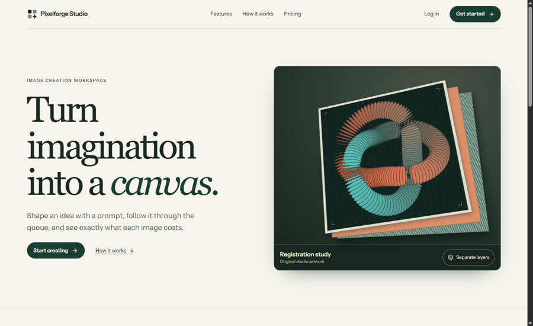
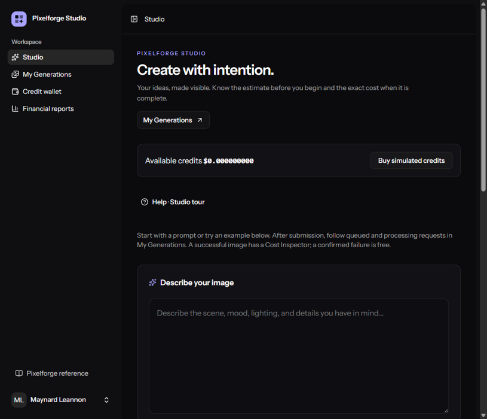
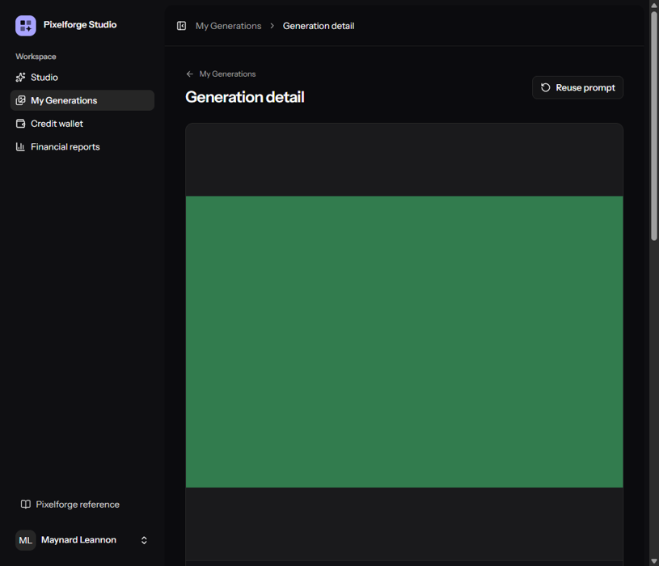
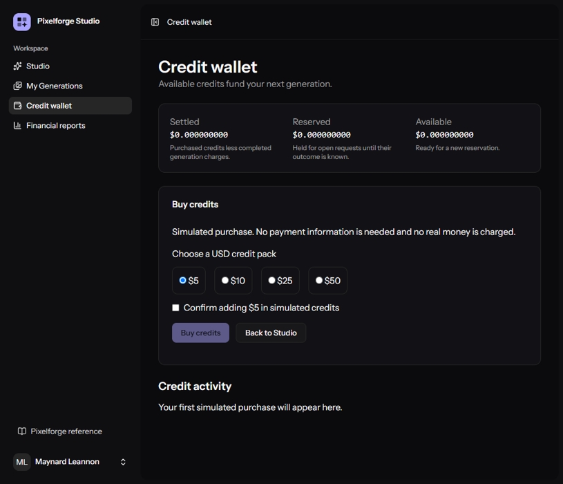
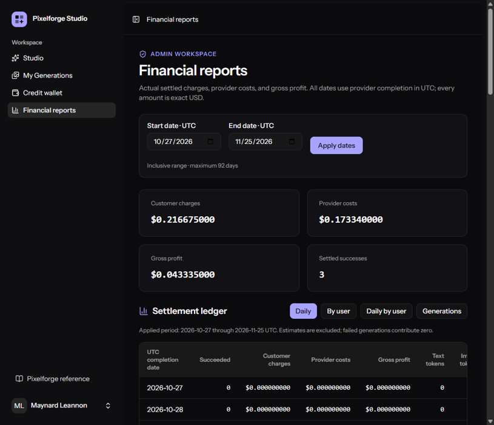
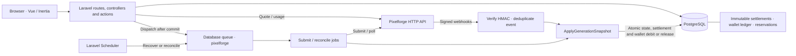

# Pixelforge Studio

Pixelforge Studio is an image-generation workspace built for the PromptEdit engineering assessment. Users get a server-calculated estimate, follow an asynchronous generation, and see the exact final charge in their history. Operators can reconcile local settlements against the provider's usage report.

The application implements real account, queue, webhook, and accounting flows. Pixelforge produces simulated images, and wallet top-ups add simulated USD credits. The app collects no payment details.

[Live demo](https://pixelforge-production-hcilan.laravel.cloud/) · [Public repository](https://github.com/AnirudhVijayaraghavan/PixelForge) · [Verification record](docs/VERIFICATION.md)

The live home and health endpoints returned HTTP 200 during final verification. GitHub main publishes the complete assessment source at `257e936`. The active Cloud revision and production financial reconciliation remain unverified. The Linux CI run for this commit failed on a case-sensitive test fixture path. [Release verification](docs/VERIFICATION.md#phase-9d-production-sign-off)

## Screenshots



<details>
<summary>Studio, generation detail, wallet, and financial reports</summary>

These local Chrome captures show the candidate UI with synthetic fixture accounts and amounts. The generation preview shows a test image.

| Studio                                                                  | Generation detail                                                                      |
| ----------------------------------------------------------------------- | -------------------------------------------------------------------------------------- |
|               |            |
| **Credit wallet**                                                       | **Admin financial reports**                                                            |
|  |  |

</details>

## What it does

| Area               | Features                                                                                                                                                                                           |
| ------------------ | -------------------------------------------------------------------------------------------------------------------------------------------------------------------------------------------------- |
| Core assessment    | Authenticated image generation with size, quality and reference URLs. Server-authoritative pricing, live lifecycle status, history, failure messages, actual charges and a Cost Inspector.         |
| Reliability        | Signed webhooks, duplicate and out-of-order delivery handling, bounded submission retries and recovery after missed callbacks.                                                                     |
| Bonus 1            | Admin-only daily and per-user reporting for customer charges, provider costs and gross profit. Key-wide provider reconciliation compares counts, token categories and costs by UTC completion day. |
| Bonus 2            | Simulated credit purchases, spendable balance and activity, maximum-cost reservations, and atomic capture or release.                                                                              |
| Product experience | Public landing page, guided Studio tour, responsive gallery and detail pages, and light and dark themes.                                                                                           |

## Run locally

Use Git, Composer 2, 64-bit PHP 8.4 with PDO SQLite and the required extensions listed by \`composer check-platform-reqs\`, and Node.js **22.18+ on the 22.x line or 24.11+ on the 24.x line** with npm. PHP 8.4 is required by the locked Pest suite. The Node ranges come from the locked Vite+ tooling. PostgreSQL and PDO PostgreSQL are required for the PostgreSQL path below.

```sh
git clone https://github.com/AnirudhVijayaraghavan/PixelForge.git
cd PixelForge
composer install
npm ci
cp .env.example .env
php artisan key:generate
```

In PowerShell use `Copy-Item .env.example .env` and `npm.cmd` if the npm PowerShell shim is blocked. Use the release-candidate branch or commit once it has been published to review this exact version.

Set the local APP_URL to \`http://localhost:8002\` in \`.env\`. The example defaults to SQLite. For a local walkthrough with that default, create a new database file using `touch database/database.sqlite` or `New-Item -ItemType File database/database.sqlite` in PowerShell. Leave `DB_DATABASE` unset so Laravel resolves the file relative to this checkout. For production parity, create a dedicated local PostgreSQL database and fill in the connection settings below. Verify the target before migrating.

```sh
php artisan migrate
npm run build
```

Start three separate terminals from the repository root:

| Process                    | Command                                                                      |
| -------------------------- | ---------------------------------------------------------------------------- |
| Laravel HTTP server        | `php artisan serve --host=localhost --port=8002`                             |
| Pixelforge database worker | `php artisan queue:work database --queue=pixelforge --timeout=30 --tries=10` |
| Local scheduler            | `php artisan schedule:work`                                                  |

The build provides static assets. For hot reload, run `npm run dev` in a fourth terminal. The scheduler runs the bounded reconciliation command every minute. Check its registration with `php artisan schedule:list`.

Open [Studio locally](http://localhost:8002), register, open **Credit wallet** and confirm a simulated purchase. Return to **Studio**, enter a prompt and review the estimate and maximum hold before generating. Open **My Generations** for progress, the result and a charge breakdown. For local operator review, an authorized operator can grant report access to an existing user with `php artisan app:admin USER_ID --force --no-interaction`.

A live generation needs a Pixelforge API key. To test callbacks from Pixelforge, configure a public HTTPS tunnel to `/webhooks/pixelforge` and use the signing secret for the same environment. With a running worker and scheduler, polling can recover a result without inbound callbacks. The automated tests use HTTP fakes for submission, signed-event processing, failure, settlement and recovery.

### Environment configuration

Copy [.env.example](.env.example) for local configuration. Keep each environment's provider key and webhook secret separate.

| Variables                                                         | Local setup                                                                                                                                                                            |
| ----------------------------------------------------------------- | -------------------------------------------------------------------------------------------------------------------------------------------------------------------------------------- |
| `APP_KEY`, `APP_URL`, `APP_ENV`, `APP_DEBUG`                      | Generate the local key once. Set the URL to `http://localhost:8002`. The example uses `local` and debug enabled. Use HTTPS and disable debug on any public environment.                |
| `DB_CONNECTION`                                                   | `sqlite` in the example. Use `pgsql` for PostgreSQL.                                                                                                                                   |
| `DB_HOST`, `DB_PORT`, `DB_DATABASE`, `DB_USERNAME`, `DB_PASSWORD` | Set these for your dedicated PostgreSQL target. The driver's default port is 5432. Leave `DB_URL` unset when using explicit connection settings.                                       |
| `QUEUE_CONNECTION`, `PIXELFORGE_QUEUE_CONNECTION`                 | Both default to `database` in the example. The worker listens on `pixelforge`. `DB_QUEUE_RETRY_AFTER` defaults to 90 seconds and must exceed 35 seconds for the 30-second job timeout. |
| `CACHE_STORE`, `SESSION_DRIVER`                                   | The example uses `database` for both. Migrations create the necessary tables. Shared cache supports application locks and rate limits.                                                 |
| `PIXELFORGE_BASE_URL`                                             | Defaults to `https://pixelforge.promptedit.dev/v1`.                                                                                                                                    |
| `PIXELFORGE_API_KEY`, `PIXELFORGE_WEBHOOK_SECRET`                 | Supply private environment-specific credentials for live requests and signed callbacks respectively. The example leaves both blank.                                                    |
| `APP_NAME`, `VITE_APP_NAME`, `MAIL_MAILER`                        | App label and local mail transport. The example logs mail. Configure real mail separately if desired.                                                                                  |
| `PASSKEYS_USER_HANDLE_SECRET`                                     | Optional stable passkey secret. Defaults to `APP_KEY`.                                                                                                                                 |

## Architecture

Laravel 13, Fortify and Eloquent own the HTTP and persistence boundaries. Vue 3, Inertia 3, TypeScript and Wayfinder drive the interface, styled with Tailwind 4 and shadcn-vue. Brick Math handles exact billing arithmetic.



- **Admission.** Laravel prices the immutable request and reserves the maximum expected charge under a wallet row lock. It persists local identity and a stable provider idempotency key before queueing.
- **Delivery.** The dedicated client sends immutable parameters with that key and handles provider rate limits, overload and ambiguous timeouts. The webhook verifies the signed raw body and timestamp. An event ID is deduplicated durably and local request metadata can resolve a callback that arrives before the POST response.
- **Recovery.** POST responses, callbacks and polls converge on the same snapshot action. Stale updates cannot regress a terminal state. The scheduler recovers stranded jobs and missed callbacks within attempt budgets. Uncertain outcomes keep their holds and may need operator investigation.

### Financial correctness

One USD equals one billion integer nanodollars. The app computes provider cost from confirmed token counts and the immutable rates accepted for that generation. It applies the 25% markup once to the total, rounding the customer charge half-up to the nearest nanodollar. Aggregates use arbitrary precision and the UI receives decimal strings.

For example, if the maximum hold is **$0.050000000** and a success costs Pixelforge **$0.024000000**, the customer pays **$0.030000000**, or 30,000,000 nanodollars. Settlement captures that amount and releases **$0.020000000**. A confirmed failure charges **$0.000000000** and releases the hold in full.

Wallet row locks serialize competing admissions and purchases. A generation row lock serializes webhook and polling updates. Unique constraints prevent duplicate reservations, settlements and debits. A composite foreign key requires a wallet debit to match the recorded charge, and triggers protect ledger entries and settlements from updates or deletes. History created before wallet admission retains its original settlement without a retroactive debit.

### Design decisions

- **Dedicated Pixelforge client.** The Laravel HTTP client and typed provider DTOs keep this one provider's idempotency, retry, callback and usage contracts explicit. Introducing Laravel AI SDK would add an abstraction while those provider-specific responsibilities would remain.
- **Integer money and immutable facts.** Stable snapshots and immutable settlements make repeated processing and later audits reproducible. Decimal arithmetic keeps nine-place prices exact where binary floating point would lose precision.
- **Queue plus reconciliation.** Request latency stays independent of generation latency. Signed callbacks are the fast path and bounded polling closes gaps in delivery.
- **PostgreSQL locks.** Transactional row locks make an affordability check and hold one decision without serializing all users.
- **CSS perspective.** The landing artwork uses layered SVG, CSS perspective and reduced-motion styles to retain the depth interaction with no WebGL runtime or Three.js bundle.

See [Architecture](docs/ARCHITECTURE.md) and [Pixelforge API reference](https://pixelforge.promptedit.dev/docs).

## Tests and quality

```sh
composer test
composer lint:check
npm run types:check
npm run check
npm run build
```

`composer test` runs Pint, PHPStan and Pest against guarded in-memory SQLite. The frontend commands check types, formatting and linting, and build production assets. Build once before a standalone type check on a fresh checkout so Wayfinder can generate the route and action types.

The opt-in PostgreSQL suite uses Python 3, PDO PostgreSQL and local PostgreSQL server tools. It provisions temporary loopback clusters and uses separate PHP processes for contention tests.

```sh
python tests/Postgres/run.py
```

If `initdb` is outside PATH, supply `--bin` with the PostgreSQL bin directory. See [verification evidence](docs/VERIFICATION.md) and [manual scenarios](docs/MANUAL_TESTING.md).

## Deployment and limitations

Laravel Cloud serves the application. The candidate runbook uses PostgreSQL for persistence and the database queue, a dedicated `pixelforge` worker and a minute scheduler. The cutover requires draining old processors before opening wallet-funded admission. Follow the [release runbook](docs/RELEASE_RUNBOOK.md) for migration order, health checks, reconciliation and forward recovery.

- Pixelforge output and credit purchases are simulated. Provider image URLs expire after 24 hours. The application keeps history and costs after expiry.
- A reservation uses quoted rates. Exceptional accepted-rate drift can exceed the hold and show a deficit. An ambiguous submission retains the hold until its outcome is known.
- Safari and manual screen-reader checks remain open. The deployed revision, production financial reconciliation and the full production rollout remain unverified.

## License

The repository's [LICENSE](LICENSE) contains The Unlicense. Composer metadata currently declares MIT. The proposed metadata correction is `"license": "Unlicense"`, pending maintainer approval.
